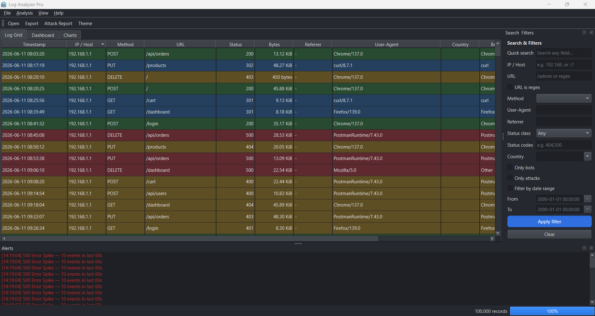
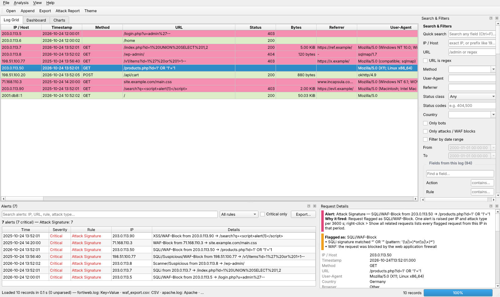
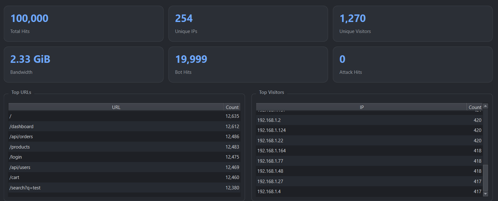
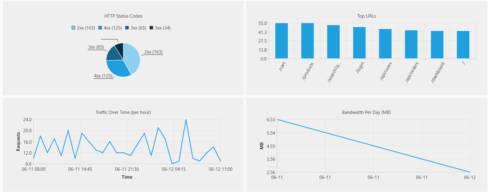
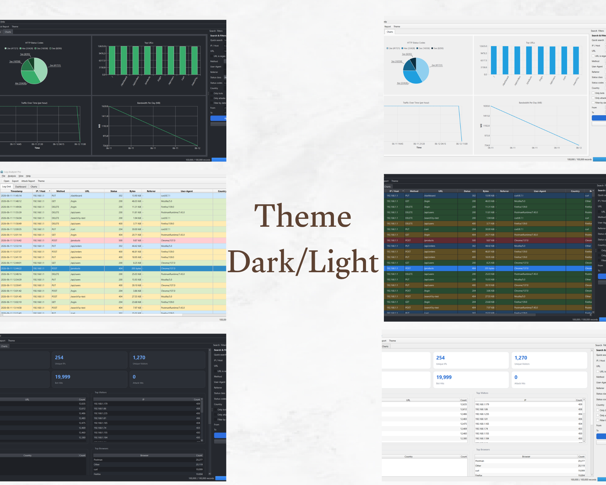

# Log Analyzer Pro

**A fast, native Windows desktop analyzer for web-server & WAF logs — Apache · Nginx · IIS · FortiWeb · Cloudflare · AWS/Azure WAF · ModSecurity · Imperva · F5 · any CSV.**
by **Sohaib JadAllah**

[](../../releases/latest)


## ✨ Overview

Log Analyzer Pro is a self-contained native desktop tool that turns raw web-server and
WAF logs into searchable, filterable insight — fully **offline**, no cloud, no telemetry.
It loads **millions of lines** (one file or many merged) in parallel on all CPU cores
while the window stays responsive, and ships a modern light/dark UI with dashboards,
charts, built-in attack detection and alerts that take you straight to the evidence.

> Designed as a faster, blue-team-friendly alternative to classic log viewers.

## 📸 Screenshots

### Log Grid


### Alerts → the exact request that triggered them


### Dashboard


### Charts


### Dark mode


## 🚀 Features

- **Formats (auto-detected per file):** Apache (Common/Combined), Nginx, IIS W3C; **WAF/CDN JSON** (Cloudflare, AWS WAF, Azure WAF, Google Cloud Armor, ModSecurity, Akamai); **key=value syslog** (FortiWeb, FortiGate, Sophos); **CEF/LEEF** (Imperva, F5 ASM); **any CSV/TSV** with a header row — every source field becomes a column.
- **Built for millions of rows:** 2M+ lines load in parallel on all cores with no "Not Responding" (worst UI pause ~0.2 s); search & filters run in the background (UI pause < 50 ms on 2M rows).
- **Inputs:** `.log` / `.txt` / `.gz` / `.csv` / `.json`; merge multiple files (even of different formats) or open each separately; **Access** and **Error** logs; **Append**; **Remote** logs over HTTP/HTTPS; *Open With Format…*.
- **Search & filters:** IP (boundary-aware), URL, method, user-agent, referrer, country, status, date range, bots/attacks, regex — plus **per-column filters on any field** (Excel-style value checklist), right-click *Filter = this value*, and search boxes for every source column.
- **Security:** bot detection and attack flagging (SQLi, XSS, traversal, command injection incl. Log4Shell, scanners), brute-force correlation, WAF-blocked requests flagged from the WAF's own fields.
- **Alerts → evidence:** **every alert is listed** (hundreds of thousands — searchable, sortable, filter by rule/severity, CSV export). Click an alert to jump to the exact request; the details pane explains why it fired and which signature matched.
- **Statistics & charts:** hits, unique visitors, bandwidth, top URLs/IPs/referrers/countries/browsers/OS, status breakdown, traffic over time.
- **GeoIP:** country + city per IP (IPv4/IPv6) from a free **DB-IP Lite** or MaxMind GeoLite2 `.mmdb` file — see below.
- **Real-time monitoring:** tail an active log with rotation handling.
- **Export:** CSV / JSON of exactly what you see, HTML, PDF (formula-injection-safe CSV).
- **Themes:** polished light & dark modes.

## 📥 Install

1. Go to **[Releases](../../releases/latest)** and download `LogAnalyzerPro-<version>-win64-setup.exe`.
2. Run the installer (Start-menu + Desktop shortcuts). No extra runtime is needed — Qt, the MSVC runtime and all DLLs are bundled.
3. Launch **Log Analyzer Pro**, then **File → Add Access Log…**.

> **"Windows protected your PC"?** The installer is not code-signed yet, so SmartScreen
> warns about an unknown publisher. Click **More info → Run anyway**.
> You can verify the download against the `.sha256` file published with each release:
> ```
> certutil -hashfile LogAnalyzerPro-<version>-win64-setup.exe SHA256
> ```

## 🌍 GeoIP (optional, free)

1. Download **IP to City Lite** (MMDB format) from [db-ip.com/db/lite.php](https://db-ip.com/db/lite.php) and unzip the `.gz` to get the `.mmdb` file.
2. In the app: **Analysis → Set GeoIP Database…** and pick the file. It is remembered for next time.
3. Refresh it monthly for up-to-date data.

MaxMind **GeoLite2-City** `.mmdb` works too (free MaxMind account).

## 📝 Changelog

See the [Releases](../../releases) page for what's new in each version.

## 👤 Author

**Sohaib JadAllah** — cybersecurity / blue-team & systems developer.
🔗 [LinkedIn Profile](https://www.linkedin.com/in/sohaibjadallah) · [SRJTools](https://github.com/SRJTools)

---

<sub>IP geolocation data (when you use a DB-IP database): [IP Geolocation by DB-IP](https://db-ip.com), licensed under CC BY 4.0.</sub>
